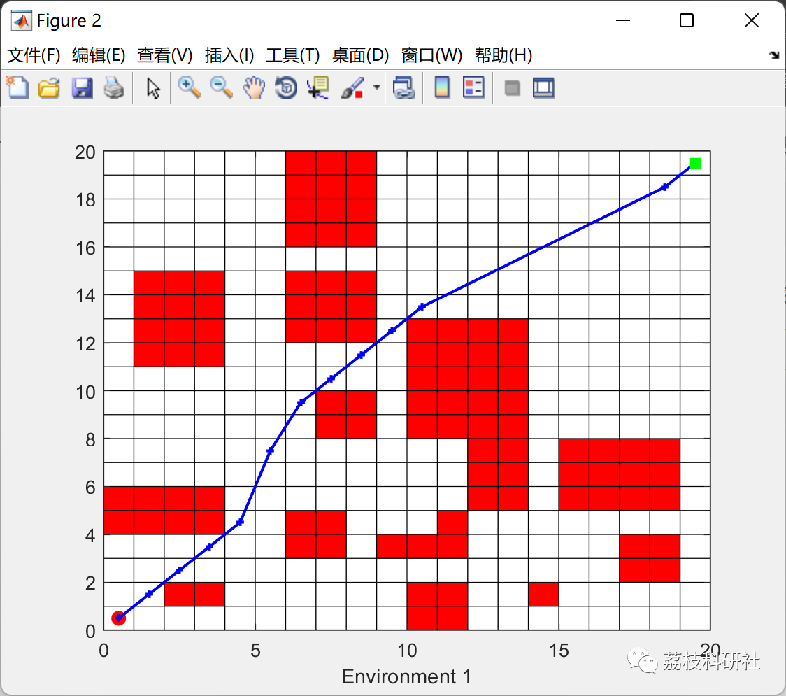
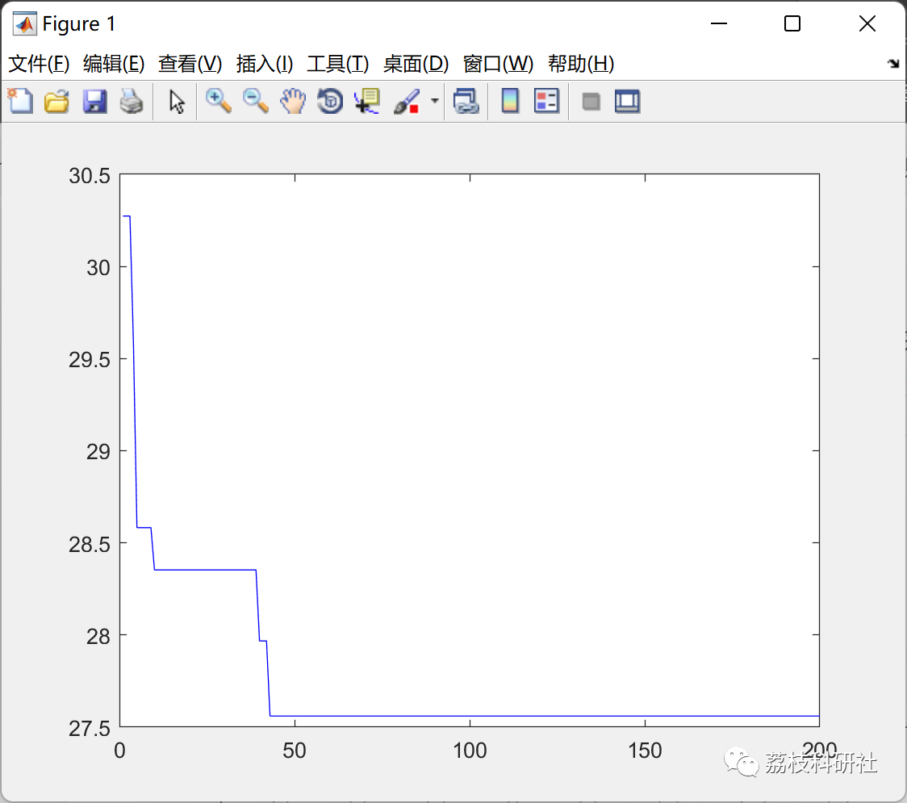

# Path Optimization Problem Based on Sparrow Optimization Algorithm (Matlab Code Implementation)

💥💥💥💞💞💞 Welcome to this blog❤️❤️❤️ 💥💥💥
🏆 Bloggers' Advantages: 🌞🌞🌞 The content of the blog strives for rigorous thinking and clear logic, making it convenient for readers.
⛳️ Mantra: A journey of a thousand miles is begun with a single step.
Litchi Research Society
Code Collection: Electric power systems, intelligent algorithms and their applications, neural network prediction, path planning, optimization dispatching, workshop scheduling, image processing, signal processing...
🎁 Special Section Links:
🌈🌈🌈🌟🌟🌟 Electrical Code Drone and Physical Application Path Planning Intelligent Algorithms and Their Applications Optimization Dispatching Neural Network Prediction Workshop Scheduling Image Processing Romantic Her Signal Processing Mathematical Modeling My Thoughts Voice Processing Complete Code Issues
💥1 Overview
Path planning is an important part of the research field in mobile robot technology. Facing increasingly complex work environments, traditional path planning techniques face various challenges such as large computations, poor completeness, and the need for precise environmental modeling, which are difficult to meet modern real-world needs. Therefore, intelligent optimization algorithms that do not require precise environmental modeling and have simple structures and high generality become emerging hotspots in path planning research.
The Sparrow Search Algorithm is a group intelligence optimization algorithm proposed in 2019, inspired by the foraging and anti-predation behaviors of bird populations. Due to its simplicity and fast convergence speed, the Sparrow Search Algorithm has been applied in some practical engineering problems. Therefore, this study focuses on the path planning problem of mobile robots based on the Sparrow Search Algorithm.
📚2 Run Results
🎉3 References
[1] Zhang Enhao. Study on path planning algorithm of mobile robots based on Sparrow Search Algorithm [D]. Chongqing University of Technology, 2022. DOI: 10.27753/d.cnki.gcqgx.2022.000820.
👨‍💻4 Matlab Code
Click the article's lower left corner to read more

## Images

<!-- PAYMENT_BLOCK -->

## Get this dataset

- Payment link (Stripe): [Buy now](https://buy.stripe.com/3cs8yP7sY87d0vu9AB)
- Payment QR code: 

<!-- /PAYMENT_BLOCK -->
